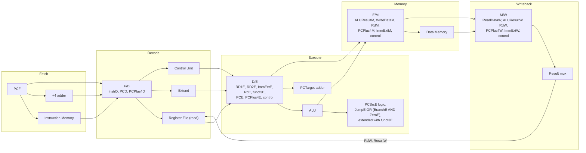

This is built on Harris & Harris §7.5 and Figures 7.47–7.51, aligned to the datapath already implemented. Terminology, signal suffixes, and the concrete numbers below now match the book's own naming exactly, so this document can be read side-by-side with Figure 7.51.

**Where this design goes beyond the book's baseline figure.** Figure 7.51 supports R-type ALU instructions, `lw`, `sw`, `beq`, `jal`, and I-type ALU instructions. The datapath already built also supports `sltu`/shifts/`xor`, all six branches, `lui`, `auipc`, and `jalr`. Every place this causes the pipelined design to need something Figure 7.51 doesn't show is called out explicitly below, rather than left implied.

---

## 0. Terms and naming convention

|Term|Meaning|
|---|---|
|Fetch, Decode, Execute, Memory, Writeback|The five stage names, exactly as the book names them — not the IF/ID/EX/MEM/WB abbreviation from other textbooks|
|Suffix F, D, E, M, W|Appended to a signal name to mark which stage it belongs to, e.g. `InstrD` is `Instr` as it exists in the Decode stage|
|Pipeline register|A clocked register between two stages; referred to below by its stage boundary, e.g. the `F/D` register, the `D/E` register|
|Hazard|A situation where overlapping instructions in the pipeline would produce a wrong result if nothing were done about it|
|Bubble / stall|An inserted cycle of no-op, holding an instruction back until a hazard clears|
|Flush|Discarding instructions already fetched, because they turned out to be the wrong ones|
|Forwarding / bypassing|Routing a value directly from a later stage back to an earlier stage, instead of waiting for it to reach the register file|

---

## 1. Why the single-cycle design wastes time

**Definition of the single-cycle design's timing.** Every instruction is clocked once per instruction. The clock period must be long enough for the slowest instruction's entire combinational path — instruction fetch, register read, ALU computation, memory access, register writeback — to finish within one period.

**Consequence.** `lw` uses every one of those steps. `add` never touches data memory at all. Both still take the same clock period, because the period is set by `lw`'s path length, not `add`'s. Every cycle, whatever hardware the current instruction doesn't need sits idle for the entire period.

---

## 2. The datapath split into five stages

|Stage|Suffix|Blocks from the existing datapath|What happens|
|---|---|---|---|
|**Fetch**|`F`|`PC`, `Instruction Memory`, `+4` adder|Read `Instr` at address `PC`; compute `PCPlus4`|
|**Decode**|`D`|`Register File` (read ports), `Extend`, `Control Unit`|Read `RD1`/`RD2`; generate `ImmExt`; decode `Instr` into control signals|
|**Execute**|`E`|`ALU`, `PCTarget` adder, branch-resolution logic|Compute `ALUResult`; compute `PCTarget = PC + ImmExt`; produce `Zero`; resolve `PCSrc`|
|**Memory**|`M`|`Data Memory`|Read or write memory at `ALUResult`, using `WriteData`|
|**Writeback**|`W`|`Result` mux, `Register File` (write port)|Select the writeback value; write it to the destination register|

This is a partition of existing hardware. No block computes anything differently than it already did.

**Resolving `PCSrc` is Execute-stage work, and Figure 7.51 shows why concretely.** The Control Unit in Decode produces `BranchD`, `JumpD`, and `ALUControlD` — but it cannot know whether a branch is _taken_, because that needs `ZeroE`, which the ALU hasn't produced yet. In Figure 7.51, `PCSrcE` is built from `JumpE` OR'd with `(BranchE AND ZeroE)` — both `JumpE` and `BranchE` are just the Decode-stage flags carried one stage forward through the `D/E` register, combined _in Execute_ with `ZeroE`, the ALU's own fresh output. That OR/AND gate cluster sits at the top of Figure 7.51 for exactly this reason: it can't be evaluated any earlier than Execute.

Because the datapath here also has `blt`/`bge`/`bltu`/`bgeu` (checked against `ALUResult[0]`, not `Zero`) and `jalr` (whose target is `ALUResultE` with bit 0 cleared, not `PCTargetE`), `PCSrcE` here needs `funct3E` as an extra input to that same gate cluster, and needs to select among three targets instead of two — the reasoning already worked out for the single-cycle branch table, now evaluated inside the Execute stage instead of instantaneously. Figure 7.51's OR/AND structure is the version sized for its own narrower instruction set; the shape doesn't change, only the number of inputs and outputs does.

---

## 3. What pipelining actually does

**Definition.** In the single-cycle design, an instruction fully finishes before the next one starts. Pipelining changes this: a new instruction enters Fetch every clock cycle, so up to five instructions are each in a different stage at once.

**This requires the stages to be physically separate hardware**, which they already are — instruction memory, register file, ALU, data memory, and the result mux are already distinct blocks, nothing shared between stages.

|Instruction|1|2|3|4|5|6|7|8|
|---|---|---|---|---|---|---|---|---|
|`add x1,x2,x3`|F|D|E|M|W||||
|`sub x4,x1,x5`||F|D|E|M|W|||
|`and x6,x7,x8`|||F|D|E|M|W||
|`or x9,x10,x11`||||F|D|E|M|W|
|`lw x12,0(x13)`|||||F|D|E|M|

By cycle 5, all five stages hold five different instructions simultaneously.

---

## 4. Pipeline registers

**Definition.** A clocked register at each of the four stage boundaries, latching the upstream stage's outputs on every clock edge and holding them stable for the downstream stage to read for one full cycle. Four registers: `F/D`, `D/E`, `E/M`, `M/W`.

**The rule for what each register carries: every value any later stage needs, not just the next one.** If a value is produced early but not consumed until several stages later, it still has to occupy a field in every intermediate register in between, even in stages that do nothing with it.

**`F/D`** carries: `InstrD`, `PCD`, `PCPlus4D`.

**`D/E`** carries: `RD1E`, `RD2E`, `ImmExtE`, `RdE` (`= InstrD[11:7]`, not needed until Writeback but only decoded in Decode), `PCE`, `PCPlus4E`, and the control signals: `ALUControlE`, `ALUSrcE`, `ResultSrcE`, `MemWriteE`, `RegWriteE`, `BranchE`, `JumpE`, and `funct3E` (needed again in Execute for the `PCSrc` resolution in Section 2, separately from its use in Decode to pick `ALUControl`). `ImmSrcD` is _not_ carried past this point — it only exists to produce `ImmExtE`, and nothing downstream reads it again.

**`E/M`** carries: `ALUResultM`, `WriteDataM` (`RD2E` passed straight through, unchanged, for `sw`), `RdM`, `PCPlus4M`, `ImmExtM` (still needed at Writeback, for `lui`), and `MemWriteM`, `ResultSrcM`, `RegWriteM`. `ALUSrc`, `ALUControl`, `funct3` stop here — they were only needed to run the ALU once, in Execute.

**`M/W`** carries: `ReadDataW`, `ALUResultW`, `PCPlus4W`, `ImmExtW`, `RdW`, `RegWriteW`, `ResultSrcW`.

**The known failure mode, exactly as the book presents it.** Figure 7.49(b) has this error deliberately built in: the register file's write address comes from `RdD` — read directly out of the `F/D` register's `InstrD` field — while the write _data_ comes from `ResultW`, four stages later. In the trace of Figure 7.48, this writes `lw`'s result to whatever register happens to be sitting in `InstrD[11:7]` during the Writeback cycle — some later instruction's destination, not `lw`'s. Figure 7.50 fixes this by pipelining `Rd` itself through `RdD → RdE → RdM → RdW`, so the register number reaching the write port in Writeback is the _same instruction's_ register number that traveled alongside `ResultW` the whole way, not whatever happens to be at that field's address four cycles later. Any signal read straight from an early stage's field instead of being carried forward through the registers will hit this same bug — this is the general form of the mistake, `Rd` is just the book's worked example of it, and `ImmExt`'s survival to Writeback for `lui` above is the same principle applied a second time.

---

## 5. Latency vs. throughput — the book's own numbers

**Single-cycle latency**, using Table 7.7's component delays: instruction memory read 200 ps, register file read 100 ps, ALU 120 ps, data memory read/write 200 ps, register file write 60 ps. Total: `200+100+120+200+60 = 680 ps` per instruction, one instruction at a time.

**Pipeline stage width.** Every stage shares one clock, so every stage's cycle time must be the same, and that shared width is set by the _slowest_ stage — here, 200 ps, matching Fetch (instruction memory read) and Memory (data memory read/write). Decode's actual work (100 ps) and Writeback's actual work (60 ps) both finish well inside 200 ps and then sit idle for the remainder of the cycle. That idle remainder is the gap visible in Figure 7.47(b)'s Decode and Writeback boxes — real work followed by dead time, because the stage can't hand off early; it has to wait for the shared clock edge.

**Pipeline latency:** `5 × 200 = 1000 ps` per instruction — _longer_ than the single-cycle design's 680 ps, precisely because the stages are unequal and every stage is stretched to match the slowest one.

**Throughput.** Single-cycle: `1 / 680 ps ≈ 1.47 billion instructions/second`. Pipelined: one instruction completes every 200 ps once the pipeline is full, `1 / 200 ps = 5 billion instructions/second`. Speedup: `5 / 1.47 ≈ 3.4×` — a real, large improvement, but not the ideal 5× a naive "five stages, five times faster" argument would suggest, because the stages aren't balanced.

**The general relationship, stated once:** pipelining raises throughput toward (number of stages)×, with the actual factor bounded above by how evenly the stage delays are balanced, and it does this while making every individual instruction's latency the same or worse, never better.

---

## 6. Hazards

### Structural hazard

**Definition.** Two instructions in the pipeline need the same hardware resource in the same cycle.

**Instruction memory vs. data memory:** already two separate blocks, so Fetch and Memory never collide.

**The register file specifically — resolved by clock-edge discipline, not extra hardware.** The register file is read in Decode and written in Writeback, by two different instructions, in the same physical cycle. The book's design resolves this with a specific timing choice: the register file writes on the _falling_ edge of the clock and reads combinationally the rest of the cycle, so a write completes in the first half of the cycle and a read in the second half sees the just-written value. This is exactly what Figure 7.48 shows in cycle 6: the register file writes a sum to `s3` and, in that same cycle, reads `t4` for a different instruction — no conflict, because the write has already landed before the read happens within that cycle.

### Data hazard

**Definition.** An instruction in Decode needs a register value that an earlier, still-in-flight instruction hasn't written back yet.

|Instruction|1|2|3|4|5|
|---|---|---|---|---|---|
|`add x3, x1, x2`|F|D|E|M|**W**|
|`sub x5, x3, x4`||F|**D**|E|M|

`sub` reads `x3` in Decode, cycle 3. `add` doesn't write `x3` until Writeback, cycle 5. Read naively, `sub` gets the stale value.

The book's own Figure 7.48 shows the same shape: if `add s3, s9, s10` had instead used `s2` as a source, that would be a hazard, because `s2` isn't written by `lw` until `lw`'s Writeback — two cycles after `add`'s Decode needs it.

**Resolution (later stage, not this one): forwarding** — routing `ALUResultM` or `ResultW` directly back into the ALU's operand mux for the dependent instruction, bypassing the register file, so the value is available by the time it's actually needed in Execute rather than waiting for Writeback.

### Control hazard

**Definition.** A branch or jump's outcome isn't known until partway through the pipeline, but Fetch has already fetched several instructions assuming the PC just kept incrementing.

**The feedback path already exists in Figure 7.51, and that's exactly the problem, not the fix.** `PCSrcE` is computed in Execute and fed straight back to the mux driving `PCF'`, at the very start of Fetch — a wire that crosses backward over the Decode and the (not-yet-existing) intervening stages in zero cycles, combinationally. That wire being present doesn't mean control hazards are handled; it only means the _correct redirect target_ becomes available at the right time. It says nothing about the two instructions that Fetch and Decode have already pulled in, assuming sequential `PC+4`, during the cycles before that redirect arrives.

|Instruction|1|2|3|4|5|
|---|---|---|---|---|---|
|`beq x1, x2, target`|F|D|**E (ZeroE known here)**|M|W|
|next sequential instr||F|D|?|?|
|next sequential instr|||F|?|?|

Two instructions are already in the pipeline, fetched on the assumption the branch wasn't taken, by the time `PCSrcE` resolves at the end of cycle 3. If the branch _was_ taken, both must be flushed — their control signals zeroed before they can write anything, turning them into no-ops.

---

## 7. What this next implementation stage is, and isn't

**Implementing the pipeline registers means:** building the four registers (`F/D`, `D/E`, `E/M`, `M/W`) with the exact field lists from Section 4, and rewiring each stage to read from the register before it and write into the register after it — replacing the single-cycle design's shared wires.

**The one correctness trap to check for explicitly, because the book shows it happening:** every signal belonging to a given instruction — data values, the destination register number, every control signal — must be latched at every boundary and read back out of the matching register at each stage, never read fresh from an earlier stage's field once that instruction has moved on. `RdD` read directly at the Writeback stage, instead of `RdW` pulled through all four registers, is the book's worked example of exactly this mistake (Section 4).

**It does not mean handling hazards yet.** With only the registers in place — no forwarding, no stalling, no flushing — the pipeline is correct only for instruction sequences with no data or control dependencies between nearby instructions. That's expected: the registers are what make overlap physically possible; forwarding, stalling, and flushing (built on top of this, largely via a hazard-detection unit comparing register numbers across the pipeline registers) is what makes overlap correct, and comes after.

---

**The core fact to hold onto:** pipelining doesn't make any single instruction faster — here, latency actually goes from 680 ps to 1000 ps. What it buys is throughput, by running five instructions through five separated stages at once; the book's own numbers put that at 3.4× rather than an ideal 5×, because the shared clock forces every stage to be as wide as the slowest one. Pipeline registers are the plumbing that makes the overlap physically possible, and the one way to get that plumbing wrong is letting a signal fall out of sync with the rest of its instruction — exactly the `RdD`-vs-`RdW` bug the book builds in and then fixes. None of this yet makes the overlap _correct_ when instructions depend on each other; that's hazards, solved separately, afterward.

## Later explanations
### Point1
**What a single register does, in isolation — you have this exactly right.** `d_e_reg` takes `RD1D` (this cycle's value) and outputs `RD1E` (next cycle, same value, just relabeled). Nothing is computed. It's a pure delay of one clock cycle. Every one of the four pipeline registers does exactly this, for every field it carries. That part isn't the point of pipelining — it's just what a register is.

**The actual question: why insert something that does nothing but delay a value by one cycle?**

**Without the register — trace what has to happen.** Say `regfile`'s read ports feed the ALU directly, no register in between. `add x3, x1, x2` is being decoded: `regfile` outputs `RD1 = x1`'s value, `RD2 = x2`'s value, directly into the ALU. The ALU needs those values stable for as long as it takes to compute. During that entire time, `regfile`'s read ports cannot move on to reading the _next_ instruction's registers — if they did, `RD1`/`RD2` would change out from under the ALU mid-computation, corrupting `add`'s result. So `regfile` is stuck holding `add`'s values until the ALU is done with them. This is the single-cycle design: one instruction occupies the whole datapath, start to finish, before the next one can begin anything.

**With the register — trace the same moment.** `d_e_reg` captures `RD1D = x1`'s value at the clock edge, and from that instant on, `RD1E` holds that value on its own, independent of whatever `regfile` is doing. `regfile`'s read ports are now free — nothing downstream still needs them to keep outputting `add`'s operands. So on the very next cycle, `regfile` can read a completely different instruction's registers, and the ALU, working from `RD1E`/`RD2E` (frozen, correct, `add`'s values), is completely unaffected by `regfile` having moved on.

**This is the actual mechanism pipelining relies on, stated directly:** the register doesn't create speed by computing anything. It creates speed by letting the stage _before_ it stop babysitting a value the moment that value is safely captured, freeing that stage's hardware to start the next instruction immediately instead of waiting.

**Multiply this across all four registers, same cycle.** In one cycle: `f_d_reg` freezes Fetch's output, so `imem` is free to fetch instruction 5. `d_e_reg` freezes Decode's output, so `regfile`'s read ports are free to decode instruction 4. `e_m_reg` freezes Execute's output, so the ALU is free to execute instruction 3. `m_w_reg` freezes Memory's output, so `dmem` is free to service instruction 2. Meanwhile Writeback finishes instruction 1. Five pieces of hardware, five different instructions, same cycle — only possible because each register's frozen output lets the stage behind it stop waiting.

**The misconception to drop explicitly:** it is not that any individual register is doing something clever. It is that freezing a value for one stage is precisely what lets the _other_ stage stop holding it — and once every stage can let go of its instruction the moment it's done, all five stages run in parallel instead of in sequence.