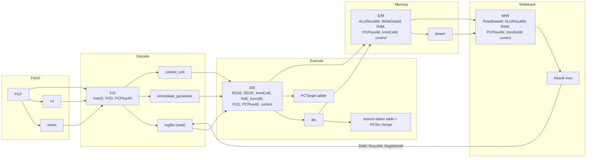

This describes the finished pipelined datapath as a working system — what each piece does, in what order, and how they connect — not what changed to get here. Read this when the pipelining spec and concepts documents have been forgotten and the question is simply: how does this processor actually run an instruction.

---

## 0. Signal-naming convention

Every signal carries a one-letter suffix marking which of the five stages it belongs to: `F` (Fetch), `D` (Decode), `E` (Execute), `M` (Memory), `W` (Writeback). `InstrD` is the instruction word as it exists during Decode. `RdW` is the destination register number as it exists during Writeback — the same register number as `RdD` was, four cycles earlier, for the same instruction, just relabeled at each stage it passes through.

---

## 1. The five stages and what hardware lives in each

**Fetch.** Holds the `pc` register, `imem`, and one adder computing `PCPlus4F = PCF + 4`. Given the current address `PCF`, this stage produces two things every cycle: the instruction word at that address (`InstrF`, straight out of `imem.RD`), and the address of the next sequential instruction (`PCPlus4F`).

**Decode.** Holds `regfile`'s two read ports, `immediate_generator`, and `control_unit`. Given `InstrD`, this stage produces the two operand values from the register file (`RD1`, `RD2`), the sign-extended immediate (`ImmExtD`), and every control signal the rest of the instruction's journey through the pipeline will need (`RegWriteD`, `ALUSrcD`, `ALUSrcAD`, `MemWriteD`, `ResultSrcD`, `BranchD`, `ALUControlD`, `PCSrcD`).

**Execute.** Holds `alu`, the `PCTarget` adder, and the branch-resolution logic. Given the operands and control signals decoded in the previous cycle, this stage computes the ALU result (`ALUResultE`), the zero flag (`ZeroE`), the branch target address (`PCTargetE = PCE + ImmExtE`), and — for a branch, `jal`, or `jalr` — the final decision about what the next fetch address should be.

**Memory.** Holds `dmem`. Given an address (`ALUResultM`) and, for a store, data to write (`WriteDataM`), this stage reads or writes data memory.

**Writeback.** Holds the `Result` mux. Given up to four candidate values (`ALUResultW`, `ReadDataW`, `ImmExtW`, `PCPlus4W`), this stage selects the one the current instruction actually wants written back, and sends it — along with the destination register number, `RdW` — back to `regfile`'s write port.

**What is true of every stage's hardware, stated once:** each block only performs one instruction's worth of work per cycle, on whatever inputs are sitting in the pipeline register directly in front of it. A stage has no visibility into any other stage, and no memory of what it computed last cycle beyond what its own pipeline register captured.

---

## 2. What each pipeline register holds, and why

Four instructions can be mid-execution at once. Each pipeline register's job is to hold one instruction's data and control signals stable for exactly one cycle, so the stage behind it can read a settled, correct value while the stage in front of it has already moved on to the next instruction.

**The governing rule:** a register must carry forward every value any later stage will still need — not only what the very next stage needs. If a value is produced early and not consumed until several stages later, it still occupies a field in every register in between, even in stages that never touch it.

**`F/D`** carries `InstrD`, `PCD`, `PCPlus4D`. `PCD` is not read by anything inside Decode itself — it exists here purely so it can reach `d_e_reg` and become `PCE`, which the `PCTarget` adder in Execute needs.

**`D/E`** carries `RD1E`, `RD2E`, `ImmExtE` (the operand and immediate values), `RdE`, `funct3E`, `PCE`, `PCPlus4E`, and every control signal Execute or a later stage needs: `RegWriteE`, `ALUSrcE`, `ALUSrcAE`, `MemWriteE`, `BranchE`, `ResultSrcE`, `ALUControlE`, `PCSrcE`. Two of these are easy to assume are "already used up" by the time they reach here, and are worth naming explicitly: `funct3E` was already read once, inside `control_unit`, to help select `ALUControlD` — but it gets read a second, independent time in Execute, for the branch-taken table (§5). `ImmSrcD` is the one signal that genuinely stops here rather than continuing — it only existed to drive `immediate_generator`, which has already finished its job by the end of Decode.

**`E/M`** carries `ALUResultM`, `WriteDataM` (a straight pass-through of `RD2E`, unchanged since Decode — this is a store's data), `RdM`, `PCPlus4M`, `ImmExtM`, and the control signals Memory or Writeback still need: `RegWriteM`, `MemWriteM`, `ResultSrcM`. `ALUSrc`, `ALUSrcA`, `ALUControl`, `funct3`, `Branch`, `PCSrc` all stop here — every one of them finished its job inside Execute and nothing downstream reads any of them again.

**`M/W`** carries `ReadDataW`, `ALUResultW`, `RdW`, `PCPlus4W`, `ImmExtW`, `RegWriteW`, `ResultSrcW` — the four candidate writeback values, the destination register, and the write enable, all that Writeback needs to finish the instruction.

**Why `PCPlus4` and `ImmExt` each survive all the way to `M/W` even though most instructions never use them there:** `PCPlus4W` is `jal`/`jalr`'s return-address writeback value; `ImmExtW` is `lui`'s writeback value. Both are produced in the first stage or two and not touched again until Writeback, several stages later — for these two instructions specifically, though every instruction carries both fields through regardless, since the pipeline registers have no way to know in advance which instruction is currently passing through them.

**Why `Rd` has to be pipelined at all, stated plainly:** the destination register number is decoded once, in Decode, from `InstrD[11:7]`. The value that actually gets written to that register, `ResultW`, isn't ready until Writeback, four cycles later. If `Rd` weren't carried forward through every register — `RdD → RdE → RdM → RdW` — the register file's write port would have no way to know which register the four-cycles-old `ResultW` value actually belongs to, and would instead see whatever `InstrD[11:7]` happens to be _right now_, which belongs to an entirely different, much later instruction.



---

## 3. One instruction's journey, cycle by cycle

Take `add x3, x1, x2`, entering the pipeline at cycle 1.

**Cycle 1 (Fetch):** `PCF` addresses `imem`. `InstrF` becomes the `add` instruction's word. `PCPlus4F` is computed.

**Cycle 2 (Decode):** `InstrD` is now this `add` instruction. `regfile` reads `RD1 = x1`, `RD2 = x2` combinationally. `control_unit` decodes `RegWriteD=1`, `ALUSrcD=0`, `ALUControlD=0000` (add), `ResultSrcD=00`. `RdD = 3`.

**Cycle 3 (Execute):** `alu` computes `ALUResultE = RD1E + RD2E` using the operands carried in from `d_e_reg`. `ZeroE` is also produced, unused for this instruction since it isn't a branch.

**Cycle 4 (Memory):** `dmem` is addressed by `ALUResultM`, but `MemWriteM=0` for `add`, so nothing is written; `ReadDataM` is produced but goes unused.

**Cycle 5 (Writeback):** `ResultSrcW=00` selects `ALUResultW`. `RegWriteW=1` and `RdW=3` drive `regfile`'s write port: `x3` is updated with the sum, on the falling edge of this cycle's clock.

**What was happening in the other four stages during cycles 2 through 5:** a different instruction in each. By cycle 5, four instructions fetched after `add` are simultaneously sitting in Fetch through Memory, each at a different point in its own five-cycle journey.

---

## 4. The register file — read in Decode, written in Writeback, same module

`regfile` is instantiated once, but it does two unrelated jobs in the same clock cycle, for two different instructions: it combinationally reads `RD1`/`RD2` using `A1 = InstrD[19:15]`, `A2 = InstrD[24:20]` — the register numbers of whatever instruction is currently in Decode — and it writes `regs[RdW] <= ResultW` using the register number and result of whatever instruction is currently in Writeback, four cycles ahead of the Decode-stage instruction.

**The write happens on the falling edge of the clock, not the rising edge.** Every other clocked block in the design — `pc`, and all four pipeline registers — updates on the rising edge. `regfile`'s write is the one exception. One clock period runs from a rising edge at `t=0` to the next rising edge at `t=T`; the falling edge sits at `t=T/2`, exactly in the middle. `RdW`, `ResultW`, and `RegWriteW` become stable at `t=0`, the moment `m_w_reg` latches them, and hold steady for the rest of the cycle. The write itself is a single event, occurring exactly at `t=T/2`: `regs[RdW]` holds its old value from `t=0` to `t=T/2`, and the new value from `t=T/2` onward.

**Why this matters for same-cycle read/write of the same register.** `A1`/`A2` are also stable from `t=0` onward, held by `f_d_reg`. `RD1`/`RD2` are purely combinational, so they track `regs[A1]`/`regs[A2]` continuously through the cycle — the old value before `t=T/2`, the new value after. If a Decode-stage instruction happens to be reading the same register a Writeback-stage instruction is writing this cycle, and `d_e_reg` captures `RD1`/`RD2` at the next rising edge (`t=T`, which is after `t=T/2`), it always captures the post-write value. This is what lets that specific case resolve correctly with no forwarding hardware and no stall.

**What this is not.** This mechanism only handles the case where the Writeback-stage instruction and the Decode-stage instruction happen to reference the same register in the same cycle — a coincidence of timing four cycles apart. It says nothing about an instruction needing a value that a _nearby_ instruction (one or two cycles ahead, not yet at Writeback) hasn't produced yet. That is a data hazard, and this mechanism does not resolve it.

---

## 5. Deciding what to fetch next

Every cycle, `pc` needs a new value to load. Three possibilities compete for that value, and the decision is made in Execute, then fed straight back to Fetch.

**The three sources.** `PCPlus4F` — the default, sequential case, always available in Fetch itself. `PCTargetE = PCE + ImmExtE` — computed in Execute, used for a taken branch or for `jal`. `{ALUResultE[31:1], 1'b0}` — `ALUResultE` with bit 0 forced to `0`, used for `jalr`.

**How the choice between them is made, in two parts.** First, `PCSrcE` — the opcode-forced value, decided back in Decode by `control_unit` and simply carried forward through `d_e_reg` — already says outright whether this instruction is `jal` (`01`) or `jalr` (`10`); for every other instruction, including branches, it's `00`. Second, if `PCSrcE` is `00`, the branch-taken table below runs, using `funct3E` (also carried forward from Decode) together with `ZeroE` and `ALUResultE[0]`, both fresh this cycle from the ALU:

|`funct3E`|Taken when|
|---|---|
|`000` (`beq`)|`ZeroE = 1`|
|`001` (`bne`)|`ZeroE = 0`|
|`100` (`blt`)|`ALUResultE[0] = 1`|
|`101` (`bge`)|`ALUResultE[0] = 0`|
|`110` (`bltu`)|`ALUResultE[0] = 1`|
|`111` (`bgeu`)|`ALUResultE[0] = 0`|

This produces one bit, `takenE`. The final selection:

```
PCNextSelE = (PCSrcE != 2'b00)  ? PCSrcE :        // jal/jalr, already known
             (BranchE & takenE) ? 2'b01  :        // this branch, taken
                                   2'b00;          // sequential
```

**Why this whole computation happens in Execute and nowhere else.** `ZeroE` and `ALUResultE[0]` don't exist until the ALU runs, which only happens once an instruction reaches Execute. `control_unit`, sitting in Decode, never has access to them for the instruction it's currently decoding — by the time that instruction's `Zero` exists, `control_unit` has already moved on to decoding a different, later instruction. So the parts of the decision that need `Zero`/`ALUResult[0]` can only be resolved in Execute, and the parts decided earlier (`PCSrcE`, `BranchE`, `funct3E`) are simply carried there to meet them.

**Why the redirect reaches Fetch the same cycle it's computed.** `PCNextSelE` and the target value it selects are fed back to the mux in front of `pc` as a direct combinational wire — not through a pipeline register. This has to happen within the same cycle, because the very next value `pc` loads, at the upcoming rising edge, depends on it.

**What this mechanism does not do.** By the time a branch's outcome is known, at the end of its own Execute cycle, Fetch and Decode have already pulled in the one or two instructions immediately following it, on the assumption it wasn't taken. If it was, those instructions are already partway through the pipeline and are not discarded by anything described here — that is separate, later work.

---

## 6. Five instructions, overlapping

```
Cycle:        1    2    3    4    5    6    7    8
add x3,x1,x2  F    D    E    M    W
lw  x4,0(x5)       F    D    E    M    W
beq x3,x4,L             F    D    E    M    W
sub x6,x7,x8                  F    D    E    M    W
or  x9,x10,x11                     F    D    E    M    W
```

At cycle 5: `add` is in Writeback, writing `x3`. `lw` is in Memory, reading `dmem`. `beq` is in Execute — this is the cycle its `ZeroE`/`ALUResultE[0]` are produced and its taken/not-taken decision is made, using `x3` and `x4`'s values as they were read back in `beq`'s own Decode cycle (cycle 4). `sub` is in Decode, reading `x7`/`x8`. `or` is in Fetch. Five separate instructions, five separate stages, each stage's hardware doing exactly one instruction's worth of work this cycle.

**The dependency this diagram does not show correctly.** `beq` compares `x3` and `x4` using values it read in its own Decode cycle (cycle 4) — but `add` doesn't write `x3` until cycle 5, one cycle _after_ `beq` already read it. Read literally, `beq` gets a stale value for `x3`. This is a data hazard, exactly the kind Section 4 said this design does not resolve; it is shown here specifically because it is the first case where the overlap in this diagram stops being harmless.

---

## 7. The core relationship to hold onto

Every stage's hardware processes exactly one instruction per cycle, using only what its own pipeline register handed it — it has no knowledge of any other instruction, past or future. The four pipeline registers exist purely to give each stage a stable, correctly-timed snapshot of one instruction's data while every other stage works on a different instruction in parallel. Correctness of any single instruction in isolation is guaranteed by this structure; correctness across instructions that depend on each other is not — that guarantee comes from hazard-handling logic layered on top, not from anything described in this document.