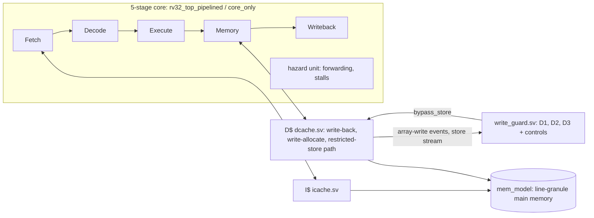

# writehammer

A 5-stage RV32I core with parameterized instruction and data caches, in which the **data cache array is treated as a modeled non-volatile memory** whose lifetime is set by the writes to its most-written line. The project measures how benign programs and write-hammer-style attack programs concentrate writes, and compares three small hardware detectors (D1 per-line counters, D2 hashed counters, D3 store-rate) that restrict stores to a hot line.

The question it answers: *which cheap hardware detector catches randomized write-hammer patterns, at what cost, and which one fails?* Short answer (numbers and sources below): the detectors that count writes per line (D1, D2) found the hammering in the "direct" attack forms with **no false positives on any benign workload**, the store-rate detector (D3) did not catch any attack and falsely flagged a benign program, and the mitigation as specified (bypass the array and invalidate the line) did **not** reduce wear, even when every store was bypassed.

## What this is not

- Not a claim that SRAM L1 caches are endurance-limited. This is a modeled-NVM study.
- Not a reproduction of the multicore threat model. One core cannot distinguish an attacker core from a benign one. Detectors operate on the store stream and cache-array writes of a single core.
- Not a replication of the group's per-core drop-at-admission throttle. That mechanism is valid only when a core is known to be malicious. Dropping stores on a benign core would corrupt results, so it is not implemented. Action A2 (stall-throttle) is the correctness-preserving analogue (and it is **not run** in this work, `docs/KNOWN_ISSUES.md` KI-020).
- Not a breakthrough. Its value is rigorous measurement and honest framing.

The attack taxonomy (RLA, RTA, RnLA, RnTA) is prior work of the author's group (TENDRA and the Write Hammer draft); this repository implements those definitions and does not claim them.

## Results at a glance

All numbers are generated from `analysis/results.csv` (9,723 runs, every one with an architectural signature equal to the caches-off core) by `analysis/results_md.py`; each row there names its run_id. Primary configuration: 2 KiB D$, 16-byte lines, memory latency 20, window 10,000 cycles, `k = 2`.

| Finding | Where |
|---|---|
| Pre-registered verdicts: H1 REFUTED, H2 INCONCLUSIVE, H3 REFUTED | `docs/HYPOTHESES.md`, `docs/RESULTS.md` section 1 |
| D1 and D2 (every M tested) flag 11 of 24 attack runs (the direct forms: RLA, RnLA, RnTA) and none of the paper forms or RTA; false-positive cycle fraction 0 on all 13 benign workloads, including `crc32` | `docs/RESULTS.md` sections 2 and 3 |
| D3 flags no attack; it flags the benign `huffbench` for 98 % of its cycles (STATIC) or 14.7 % (ADAPTIVE) | `docs/RESULTS.md` sections 2 and 3 |
| Restricting every store (ALWAYS) reduces attack array writes by 8 % on average and by at most 20.8 %: a bypassed store invalidates its line and the next load refills, and writes, it | `docs/RESULTS.md` section 4 |
| Physical cost (sky130, pinned flow): D1 adds 4.0 % (1 KiB) and 5.7 % (2 KiB) to the cache area; D3 and D2 up to M = 32 are within synthesis variation (about 2 %) of the unguarded cache, D2 at M = 64 adds 1.8 % at 2 KiB; Fmax deltas have no stable sign | `docs/RESULTS.md` section 6, `flow/cost_table.md`, `flow/area_fmax.png` |
| Whole-run PMR cannot tell the attacks from a benign hash loop (`crc32`, PMR 127.9 of 128): the pre-registered attack-validation rule fails for 23 of 24 variants and is reported as a finding, not amended | `docs/DECISIONS.md` DEC-010, `docs/KNOWN_ISSUES.md` KI-017 |

The full report is `REPORT.md`. Figures: `analysis/eval_fig_miss_*.png` (miss rate vs cache size), `analysis/eval_fig_cpi_*.png` (CPI and stall breakdown), `analysis/*_heatmap.png` (per-line write heatmaps), `analysis/sensitivity.png` (false positives vs detection latency, from `analysis/sensitivity.csv`), `analysis/exploratory_windowed.png` (post-hoc windowed PMR, labelled exploratory), `flow/area_fmax.png`. A plain-language walkthrough with interview-style questions is `docs/EXPLAIN_FOR_AUTHOR.md`.

## Architecture



`rtl/cache_system.sv` is the I$ + D$ + guard block (what the physical study synthesizes); `rtl/core_only.sv` is the same pipeline without memory, caches or observation. See `docs/rationale/` for one design note per module.

## Build and run

Requirements are in `docs/TOOLS.md` (Verilator 5.020, Icarus 12, Spike 1.1.1, riscv64-unknown-elf-gcc 13.4, Python 3.12 with the venv in `.venv/`, the pinned third-party sources fetched by `scripts/fetch_third_party.sh`). From this directory:

```
make lint            # Verilator lint, 0 warnings
make test            # unit, integration, random, benchmark, mutant and guard tests (about 1 hour)
make arch-test       # riscv-arch-test against Spike (about 1 hour, Icarus)
make attacks         # attack programs, replays, time to failure
make calibrate       # thresholds from Dhrystone + CoreMark only
make eval            # the 9,723-run evaluation matrix (long, resumable)
make plots hypotheses results   # figures, verdicts, docs/RESULTS.md, all from the CSV
make synth           # re-parse the committed physical-flow raw archive (no EDA tools needed)
make audit           # integrity audit (locks, test counts, forbidden patterns)
make all             # everything above
```

The physical flow itself (Yosys, OpenSTA in the pinned `ghcr.io/librelane/librelane` image) is author-only: `flow/README.md`.

## Repository map

`rtl/` hardware; `tb/` testbenches; `tests/` locked tests, mutants and the independent models; `sw/` C flow, benchmarks, attacks; `analysis/` scripts, CSVs, figures; `flow/` physical-cost flow; `docs/` status, decisions, change log, known issues, per-task logs, results; `logs/runs/` command logs for every result-producing command.

## Status and honesty

`docs/STATUS.md` and `docs/TRACKER.md` list every task with its status and evidence. Not done: action A2 (stall-throttle, KI-020); the T4.7 attack-validation criterion fails by its fixed rule (KI-017, DEC-010). The evaluation is a single core, a modeled NVM, one benchmark set and one attack implementation; it supports the statements in `REPORT.md` and nothing broader.
